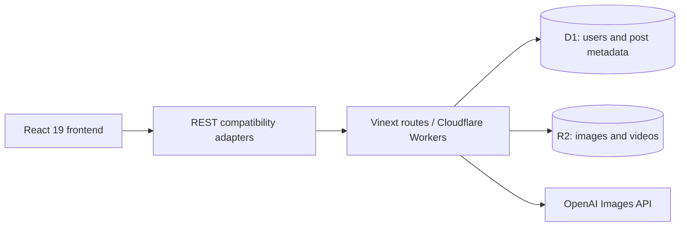

# AI Image Generation and Media Sharing Platform

**Social AI** is a full-stack portfolio project for AI image generation, image/video sharing, and media search. It migrates a starter React/Go project to React 19 and Cloudflare Workers while preserving the original frontend flows and REST contracts.

[中文说明](README.zh-CN.md) · [Benchmark methods and evidence](docs/benchmarks/README.md)

## Features

- Registration/login using salted PBKDF2-SHA256 password hashes and 24-hour HMAC-signed bearer tokens.
- Authenticated image/video uploads up to **25 MiB**, D1 metadata, R2 object storage, and server-side ownership checks for deletion.
- Author filtering and multi-keyword substring search; a composite `(user, created_at)` index supports author feeds.
- A server-side OpenAI Images API proxy that keeps provider credentials out of browser code.
- Five compatibility endpoints: `/signup`, `/signin`, `/upload`, `/search`, and `/post/:id`.

## Architecture



| Layer | Implementation |
| --- | --- |
| UI | React 19, React Router, Ant Design, Material UI |
| Server | TypeScript, Vinext/Vite, Cloudflare Workers |
| Persistence | D1 and R2; Drizzle schema/migration files |
| Verification | Production bundle tested through local Miniflare/workerd |

The active entry point is `app/SocialApp.tsx`, which mounts `src/components/App.js`. API routes live in `app/api`; `lib/server.ts` provides authentication and persistence helpers. `app/compat` and the top-level route adapters bridge the original UI to the current server.

Go source and its `handler`, `service`, `backend`, `model`, `constants`, `util`, and `conf` directories preserve the earlier Go backend as reference. They are **not the server used by the current app**. The separate top-level `components/` directory contains an earlier UI and is not the mounted frontend.

## Run locally

Prerequisites: Node.js 22.13 or later (Node 24 used for recorded benchmarks), pnpm, and a supported workerd platform.

```bash
pnpm install --frozen-lockfile
cp .env.example .env.local
```

Set `TOKEN_SECRET` in `.env.local` to a long random value. Optionally set `OPENAI_API_KEY` to enable image generation. `REACT_APP_OPENAI_KEY` is a legacy placeholder replaced by a non-secret marker in the Vite adapter; never put a real key there.

```bash
pnpm dev
```

Open the address printed by the dev server and register an account. The Cloudflare Vite plugin provides local D1/R2 bindings; schema initialization happens when the API is used. Registration, uploads, search, and deletion work without a paid AI call. Generation returns HTTP 503 when the provider key is absent.

```bash
pnpm build
```

`.openai/hosting.json` contains local binding names without an account-specific deployment identifier. Cloud deployment needs your own D1/R2 resources and server-side secrets; cloning the repository does not provision infrastructure.

## Verified behavior

These results were recorded on **2026-09-08**, using a production build in local Miniflare/workerd on an Apple M2 Pro with 16 GiB RAM. They are measurements on synthetic data, not production traffic or cloud SLAs.

| Check | Recorded result |
| --- | --- |
| Integration suite | 50 grouped checks passed |
| Legacy REST contracts | All 5 endpoints verified |
| Valid PNG/MP4 boundaries | 6 cases at limit − 1 byte, limit, and limit + 1 byte; accepted files verified by SHA-256 round trip |
| D1 insert fault injection | 50 failed uploads; 0 remaining orphan objects or rows in these tests |
| Author-feed index comparison | 100,000 synthetic posts; 500 paired queries; P95 **16.49 → 6.98 ms** (57.7% lower) versus `NOT INDEXED` |
| D1 rows read | **100,100 → 100** for the tested author query |
| Negative authentication/authorization requests | 27 rejected as expected |
| AI proxy scenarios | 8 cases with a stubbed provider |

[Raw samples, methods, and limitations](docs/benchmarks/README.md) accompany the numbers. Reruns produce different latency values.

## Reproduce the checks

```bash
pnpm test:bench
```

This builds an isolated snapshot, injects fake test secrets, and exercises the real route dispatcher against ephemeral D1/R2 storage. Provider requests are intercepted. Reports go to ignored `.bench/results/`; no live database or paid AI service is used.

For additional valid-media boundary checks, install Python 3 with Pillow and ffmpeg with libx264, then run:

```bash
pnpm test:media
```

Run `test:bench` first to create the build. Generated fixtures occupy approximately 150 MiB under ignored `.bench/fixtures/`.

## Scope and limitations

- This is a learning/portfolio implementation. The retained Go backend, including its historical authentication approach, is reference code and should not be deployed as-is.
- Upload validation checks client-supplied MIME type and byte count; it does not inspect file signatures, scan files, or transcode video.
- Media URLs are public. Cache headers and ETags are present, but conditional HTTP 304 responses are not implemented.
- Keyword search processes at most eight terms and returns at most 100 posts. It is not full-text search; no-match scans are slower than indexed author feeds.
- R2 cleanup is best-effort. Fault-injection results cover the tested insert-failure path, not every storage failure mode.
- The server has a development token-secret fallback. Set a unique `TOKEN_SECRET` before exposing an instance. Rate limiting, account recovery, and abuse prevention are not implemented.
- AI tests stub provider responses; they do not measure live image quality, latency, or provider availability.

## Project background

This repository develops a starter React/Go project into a React 19 / Cloudflare version. Portfolio work includes compatibility adapters, a Workers API with D1/R2 persistence, server-side authentication and image-generation proxying, and reproducible local verification. Legacy source is retained so the migration context remains inspectable.
